<!-- PROFILE HEADER -->
<h1 align="center">Hi, I'm Bryan Cucho Suyo 👋</h1>

  

<code>📶 ▁▂▃▄▅▆▇█ Full Coverage — Lima 🇵🇪 → Paris 🇫🇷</code>

<!-- SOCIAL / BADGES -->

  
  
  
  
  

---

  

### 🏆 Highlights

- 🥉 **3rd place — Huawei ICT Competition 2025, Global Final (China)** — Cloud Computing track (Linux, Cloud, Ansible)
- 🎓 **Top of class** — B.Eng. in Telecommunications, Universidad Nacional de Ingeniería (GPA 4.0)
- 🎤 **Speaker — KCD (Kubernetes Community Days) Lima 2026** — *"Kubernetes for 5G Cloud-Native Architectures"*

---

### 📊 GitHub Activity

  
  

  

  

<!-- Contribution snake — generated by .github/workflows/snake.yml, served from the `output` branch -->

  <picture>
    <source media="(prefers-color-scheme: dark)" srcset="https://raw.githubusercontent.com/BryanTxz10/BryanTxz10/output/github-snake-dark.svg" />
    <source media="(prefers-color-scheme: light)" srcset="https://raw.githubusercontent.com/BryanTxz10/BryanTxz10/output/github-snake.svg" />
    
  </picture>

  

---

### 🧱 Foundations (from prior experience)

`Networking Fundamentals` · `Pre-Sales Engineering` · `Technical-Commercial Documentation` · `CDN / IPTV Delivery` · `Videoconferencing Solutions`

### 🌱 Currently building toward

  
  
  
  
  
  
  
  
  
  

> Not yet claimed mastery — actively in progress. See the roadmap for what's shipped vs. planned.

---

### 🛰️ Portfolio Projects

| # | Project | Stack |
|---|---------|-------|
| 1 | **Multi-site Network Lab** — simulated WAN with dynamic routing, VLANs & QoS | `GNS3` `Containerlab` `FRRouting` |
| 2 | **Mini-CDN** — multi-region edge caching | `Docker` `Nginx` `Varnish` `Redis` |
| 3 | **5G / IoT Core Lab** — open-source mobile core with simulated IoT devices | `Open5GS` `srsRAN` `UERANSIM` |
| 4 | **Streaming Platform** — videocall/streaming app instrumented with QoS metrics | `WebRTC` `Node.js` `Grafana` |

📍 Two more projects (IaC consolidation + cloud-native capstone) are next in the pipeline. Full details and shipped/planned status in the [**telecom-portfolio-roadmap**](https://github.com/BryanTxz10/telecom-portfolio-roadmap) hub.

---

### 📡 Get in touch

  
  
  

